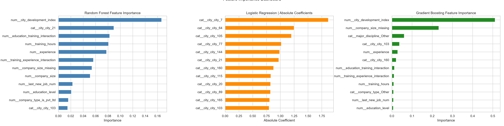
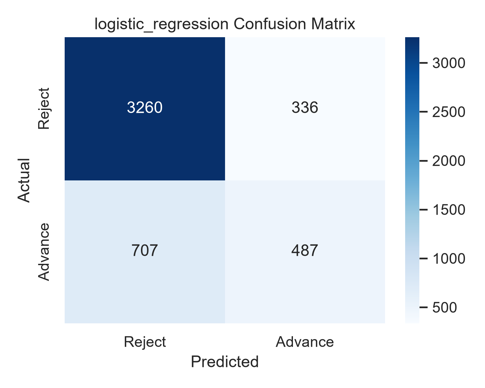
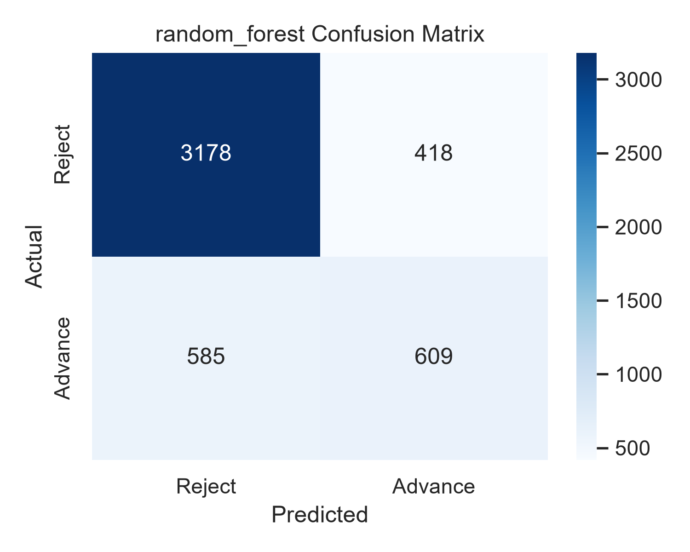
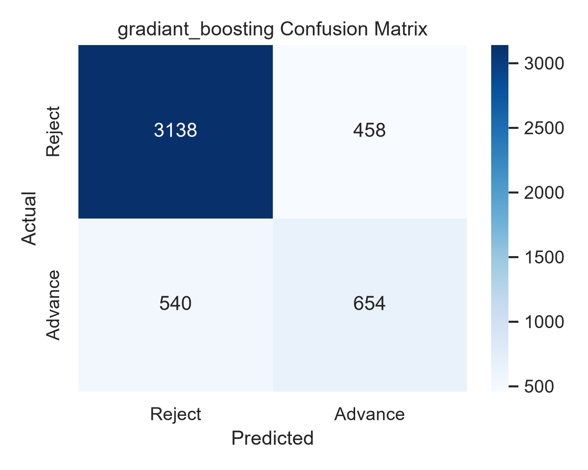

# Smart Recruitment Assistant

A machine-learning project that predicts whether a data-science candidate is **looking for a job change**, so a recruiter could focus outreach on people who are likely to be open to new opportunities.

It cleans and engineers features from a real-world HR dataset, trains and compares three classification models, evaluates them on a held-out test set, and produces charts and a ranked candidate list.

## Dataset

- **Source:** [HR Analytics: Job Change of Data Scientists](https://www.kaggle.com/arashnic/hr-analytics-job-change-of-data-scientists) on Kaggle (CC0 / public domain).
- **File used:** `aug_train.csv`: 19,158 candidates, 13 input columns plus the target.
- **Target:** `0` = not looking for a job change, `1` = looking for a job change.
- **Class balance:** about 75% are `0` and 25% are `1`, so the classes are imbalanced.
- **Missing values:** several columns have a lot of them (for example `company_type` is missing for about 32% of rows and `company_size` for about 31%), so handling them is an important part of the project.

## Approach

**1. Preprocessing and feature engineering** (`preprocess_numeric` and `preprocess_data`)

- Converted text columns such as `experience` (`>20`, `<1`), `company_size` (`50-99`, `10000+`) and `last_new_job` (`never`, `>4`) into numbers.
- Encoded `education_level` as an ordered rank (Primary School to PhD).
- Added missing-value flags (`company_size_missing`, `last_new_job_missing`) so the models can use the fact that a value was missing.
- Created interaction features such as education × training hours and training hours × relevant experience.
- Grouped rare cities and majors into `Other` and simplified `company_type` to "Pvt Ltd" or "Other".
- Built a scikit-learn `ColumnTransformer` pipeline: most-frequent imputation and one-hot encoding for categorical columns, mean imputation and scaling for numeric columns.

**2. Models** (`train_models`)

- Logistic Regression
- Random Forest
- Gradient Boosting

Each model sits in a single `Pipeline` together with the preprocessing, tuned with `GridSearchCV` (3-fold cross-validation), so the same transformations are applied at training and prediction time.

**3. Evaluation** (`evaluate_models`)

- 75% / 25% stratified train/test split (`random_state=42`), giving a test set of 4,790 candidates.
- Metrics: accuracy, precision, recall, F1-score, ROC-AUC, and a confusion matrix per model.

## Results

Test-set results (4,790 candidates):

| Model | Accuracy | Precision | Recall | F1 | ROC-AUC |
|---|---|---|---|---|---|
| Logistic Regression | 0.782 | 0.592 | 0.408 | 0.483 | 0.805 |
| Random Forest | 0.791 | 0.593 | 0.510 | 0.548 | 0.808 |
| **Gradient Boosting** | **0.792** | 0.588 | **0.548** | **0.567** | **0.812** |

**How to read these numbers**

- A model that always predicts "not looking" would already score about 75% accuracy because of the class imbalance, so **F1, recall and ROC-AUC are more informative than accuracy here**.
- Gradient Boosting performed best on F1 and ROC-AUC. It finds about 55% of the candidates who are looking for a change, and about 59% of the candidates it flags are correct.
- The three models are close to each other; the differences come from a single train/test split.
- In both tree-based models, `city_development_index` was the most important feature. Feature importance shows what the model relies on, not what *causes* a job change.

<p align="center">
  
</p>

<p align="center">
  
  
  
</p>

> In the confusion matrices, "Reject" is class `0` (not looking for a change) and "Advance" is class `1` (looking for a change).

## Repository contents

| File | Description |
|---|---|
| `project_iti.py` | Full pipeline: preprocessing, training, evaluation, ranking, charts |
| `aug_train.csv` | Dataset (from Kaggle) |
| `requirements.txt` | Python dependencies |
| `*_confusion_matrix.png`, `feature_importance_dashboard.png` | Charts generated by the script |
| `simple_dashboard.png`, `simple_dashboard.html` | Static summary dashboard saved from an earlier run. The function that generates it, `generate_simple_dashboard()`, is currently commented out in `main()` |

## How to run

Requires Python 3 (tested with Python 3.12, pandas 3.0, scikit-learn 1.8, matplotlib 3.10, seaborn 0.13, numpy 2.4).

```bash
# 1. Clone the repository and enter it
git clone https://github.com/eyadtarekk/Smart-Recruitment-Assistant-using-machine-learning-.git
cd Smart-Recruitment-Assistant-using-machine-learning-

# 2. (Recommended) create a virtual environment
python -m venv .venv
source .venv/bin/activate        # on Windows: .venv\Scripts\activate

# 3. Install dependencies
pip install -r requirements.txt

# 4. Run the pipeline (run it from the repository folder so it finds aug_train.csv)
python project_iti.py
```

The script prints each step, the metrics for every model and a top-10 candidate table, and saves the confusion matrices and feature-importance chart as PNG files in the same folder.

## Limitations and next steps

- **The top-10 ranking is not an evaluation.** It scores every row in the dataset with the Random Forest, including rows the model was trained on, so it demonstrates the ranking mechanism rather than measuring how well it ranks unseen candidates. Ranking only the test split would fix this.
- **The `GridSearchCV` grids are small.** Each parameter currently has a single candidate value, so the search runs the cross-validation but does not yet compare different settings. Adding a few values per parameter is the next step.
- **Single split.** Results come from one train/test split; cross-validated scores would give a more reliable comparison.
- **Imbalanced classes.** Class weighting or threshold tuning could improve recall for the "looking for a change" group.

## Credits

Dataset: *HR Analytics: Job Change of Data Scientists* from Kaggle.

Author: [Eyad Tarek](https://github.com/eyadtarekk) · [LinkedIn](https://linkedin.com/in/eyad-tarek-30a2473b0)
